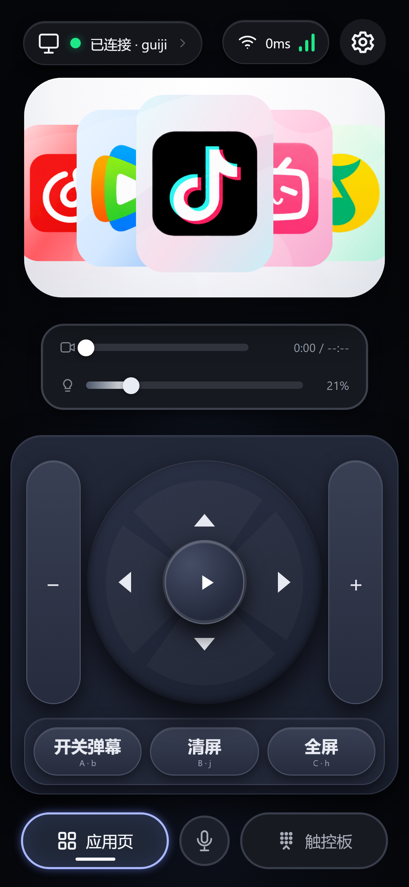
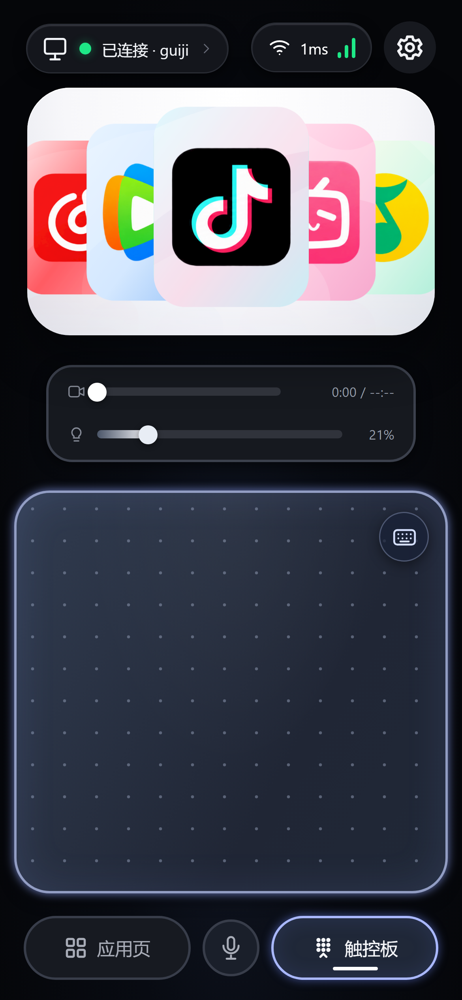
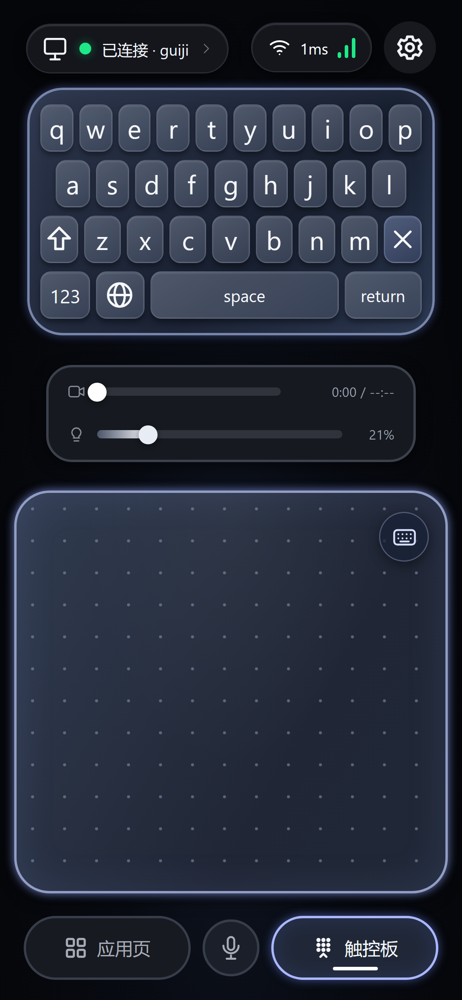

# 🛋️ Couch Commander · 沙发指挥官

> **把手机变成电脑的遥控器。人在被窝里，手在键盘上。**
>
> 大学生必备刷视频神器 —— 你不用再从床上爬下去了。

[](https://www.python.org/)
[](https://docs.aiohttp.org/)
[]()
[]()
[]()

---

## 这玩意儿到底解决什么痛点

大学的宿舍有一种独特的物理定律：**床和电脑之间的距离，被心理距离放大了 20 倍。**

你在床上刷抖音，刷到一个好视频想分享 —— 得爬起来。
你想换个视频 —— 得爬起来。
你想调一下音量、快进 30 秒跳过片头 —— **还是得爬起来。**

于是你发明了第 1001 种拖延方式：先把手机举高一点，好像这样就能遥控电脑。

**Couch Commander 就是把你举手机这个动作，变成真的遥控。**

手机扫码打开网页，你的手机就变成了：触控板、键盘、方向盘、媒体控制台、亮度旋钮。
电脑该干嘛干嘛，不用装客户端，不用连云端，不用注册账号。

> 说人话：**手机浏览器打开一个网页，你的电脑就听你的了。**

---

## 30 秒上手

**前提**：Windows 电脑 + 手机 + 同一个 Wi-Fi。**没有第二步。**

```text
1. 双击「一键启动手机遥控.bat」
2. 首次会弹一次 UAC（放行 TCP 8765），点「是」
3. 电脑上出现二维码，手机扫它
4. 浏览器提示「证书不安全」→ 点「高级」→「继续前往」
5. 玩。
```

启动器打印几行就会自己退出，**这是正常的** —— 服务已经脱离窗口在后台常驻。关掉黑窗口、关掉二维码，它照样活着。

想停：双击「一键停止手机遥控.bat」。

---

## 五个页面，各管一摊

### 🎛️ 应用页 —— 刷视频的主战场

五张卡片立体堆叠，左右滑动选应用（也可以按下面的按键选）。选中后长按中间的播放键 2 秒锁定，蓝色线框亮起来，方向盘就归这个应用了。再长按 2 秒解锁。

方向盘给的是**真正的物理方向键**，不是模拟的媒体键 —— 因为抖音、B 站这些播放器根本不监听系统媒体键，它们只认键盘上那个 ↑ ↓ ← →。

底下 A/B/C 三个快捷键，可以绑成任意组合键（`b` 开关弹幕、`j` 清屏、`h` 全屏是抖音的默认套路，内置模板一键套用）。

### 🖱️ 触控板 —— 按笔记本触控板做的，不是画了个方块

| 手势 | 效果 |
| --- | --- |
| 单指移动 | 光标跟着走 |
| 单指轻点 | 左键单击 |
| 单指双击 | 左键双击 |
| 双指滑动 | 滚轮 |
| 双指轻点 | 右键 |
| 单指按住拖 | 拖拽 |
| 双指捏合 | 缩放 |

带加速度曲线、滚动惯性和手势判定窗口 —— 手感这东西，代码里是调出来的，不是声明出来的。

### ⌨️ 键盘 —— 26 键 + 一排数字键

字母行上面还压了一排数字键。为了塞进去又不把键盘撑大，每一排的高度和键宽都重新算过 —— **加了内容，尺寸没变。**

每个键都是真的往电脑打字，不是往输入框里塞字符串。

### ⚙️ 设置 —— 快捷键你自己定

自定义名称、图标、组合键；多个页面分类管理；还能扫出电脑上装的所有应用，勾一个就出现在应用页的卡片堆里。

### ☀️ 亮度 —— 真的调背光

DDC/CI 优先，WMI 兜底，两条都是**真改显示器背光**。

> 早期版本失败时会退到 gamma 色阶，观感是「颜色发灰」而不是「变暗」—— 被用户吐槽后删了。**宁可如实说不支持，也不给一个假的。**

---

## 为什么值得一看（技术上）

这不是个套壳项目，几个地方是啃过硬骨头的：

**1. 半帧问题：0.5 秒超时能让你的连接断掉**

服务端推送消息时用 `asyncio.wait_for()` 包了个超时。超时一到就取消 `ws.send_json()` —— 而取消可能落在「帧头已写、载荷未写」之间，WebSocket 流里留下半帧，浏览器按 RFC 6455 直接判协议错误、`Close 1002/1006`。

Wi-Fi 抖一下、手机限个流就能命中，所以用户会说「**我手机都没切过后台，怎么就断了**」。

改成**有界发件箱 + 每条连接一个专职写协程**：写帧一旦开始就不会被取消，队列满了按优先级丢消息（`status`/`pong` 可以丢，控制指令不行）。三个探针脚本把这件事钉死了。

**2. 键盘扫描码：为什么 `a/s/w` 能用、`d` 就不能**

用 `SendInput` 只填 `wVk`、`wScan=0` 发出去，浏览器算出来的 `KeyboardEvent.code` 是**空字符串**。而网页播放器有的读 `event.key`、有的读 `event.code` —— 读 `code` 的那批就全哑了。

对照组实验（同一个窗口、同一批键）：

| 方式 | `d` 的 `code` | `→` 的 `code` | 结论 |
| --- | --- | --- | --- |
| 只发 VK（原实现） | `''` | `''` | 靠 `code` 匹配的全失效 |
| VK + `MapVirtualKeyW` 扫描码 | `KeyD` | `ArrowRight` | ✅ 采用 |
| 扫描码 + `KEYEVENTF_SCANCODE` | `KeyD` | 丢键 | ❌ 不可用 |

**3. WMI 参数装箱：读了成功、写了失败**

亮度读得到（`method=wmi`），写却一直返回「这台显示器不支持」。挖到底是 pywin32 按位置传参把 `WmiSetBrightness(uint8 Timeout, uint32 Brightness)` 两个形参都装成了 `VT_I4`，WMI 直接抛 `无效的参数`，然后被 `except: continue` 吞掉。

改成 `ExecMethod_` + 显式 `InParameters` 装箱，`0.3 / 0.8 / 1.0` 三档实测当场见效。

**4. 守护进程：为什么「后台」会突然没了**

旧启动器是 `python main.py` 前台阻塞 —— python 是 cmd 的子进程，**你把黑窗口一关，Windows 连它一起杀掉**。崩了也不重启、不留日志，事后完全无线索。

现在用 `DETACHED_PROCESS | CREATE_NEW_PROCESS_GROUP | CREATE_NO_WINDOW` 拉起守护进程，崩溃按 `3 → 6 → 12 → 24 → 60` 秒退避自愈，活过 300 秒重置退避。日志带毫秒，`boot` / `ws.open` / `ws.close code=...` / 每 60 秒一行 `alive uptime=... conns=... threads=... rss_kb=...`。

**5. HTTPS 不是洁癖，是麦克风的前提**

安卓 Chrome 和 iOS Safari **只在安全上下文**（HTTPS 或 localhost）才暴露 `navigator.mediaDevices`。用 HTTP 打开时它不是"被拒绝"，是**根本调不到**，授权框一次都不会出现。所以服务启动时自己签一张证书（SAN 里写 LAN IP + localhost + 主机名），手机首次点一次「继续前往」就好。

**6. 命中区：视觉 7px，触摸 34px**

滑条画出来就是 7px 的细线，但手指根本点不到。用 `::before` 铺一个 34px 高的透明热区，视觉不变、手感对了。方向盘更惨 —— 中央播放键曾经把四个方向键的内缘全盖住，用户瞄准箭头正中点，实际点到播放键。改成九宫格 `grid` 布局（`minmax(0,1fr)` 才真正等分，`1fr` 会被子元素撑开）后，四个键的命中区互不重叠。

---

## 全部功能一览

- **媒体控制**：上一首 / 播放暂停 / 下一首、进度条拖拽（**真实定位**，走 WinRT SMTC 的 `try_change_playback_position_async`，不是按方向键次数瞎猜）、显示「当前 / 总时长」
- **应用管理**：扫出电脑已装应用、加进卡片堆、长按锁定
- **触控板**：七种手势 + 加速度 + 惯性
- **虚拟键盘**：26 键 + 数字行 + 符号页 + 中文输入法切换
- **快捷键**：自定义组合键、分类页、内置抖音/B站/腾讯视频模板
- **亮度**：DDC/CI → WMI，真背光
- **语音**：长按说话，手机识别成文字后注入电脑（**不打开任何网页**）
- **断线自愈**：守护进程 + 崩溃重启 + TCP keepalive + 前端状态自检
- **零安装**：手机端只要浏览器；电脑端一个 Python 脚本

---

## 技术栈

```text
手机端  纯 HTML/CSS/JS，零框架零构建，60fps 手写动画
        └─ WebSocket 走控制指令，REST 走配置与扫描

电脑端  Python + aiohttp，单端口同源
        ├─ 静态托管 + REST + WebSocket 一个进程全包
        ├─ SendInput（ctypes）注入键鼠，带扫描码
        ├─ WinRT SMTC 读真实播放进度
        ├─ DDC/CI + WMI 控背光
        ├─ 自签名 TLS（cryptography）
        └─ 守护进程 + 崩溃自愈 + 滚动日志
```

**为什么要 HTTPS**：不是因为敏感，是因为麦克风要安全上下文。
**为什么不要 App**：装 App 要过审、要签名、要更新。网页版本永远是新的。
**为什么不用云**：你的电脑就在两米外，何必绕地球一圈。

---

## 截图

| 应用页 | 触控板 | 键盘 |
| --- | --- | --- |
|  |  |  |

---

## 自己跑起来

```bash
git clone https://github.com/guijinb666/couch-commander.git
cd couch-commander
pip install -r server/requirements.txt

# 前台跑（调试用，Ctrl+C 停）
python server/main.py

# 后台常驻（日常用）
python server/service.py start
python server/service.py status
python server/service.py logs
python server/service.py stop
```

手机访问终端打印的 `https://<你的局域网IP>:8765/`，或者扫 `server/qr.png`。

**首次启动会自动装依赖**，包括那一串 `winrt-Windows.*` —— 它们是可选的，只影响真实播放进度；装不上时进度条按估算走，右侧显示 `--:--`，其它功能不受影响。

---

## 验证（不是嘴上说说）

项目里带了一整套零副作用自检脚本，`tools/` 下：

| 脚本 | 管什么 | 结果 |
| --- | --- | --- |
| `selftest.py --offline` | 协议契约、端点、消息字段 | 66 / 66 |
| `_bugfix_check.py` | 历史缺陷不再复发 | 13 / 13 |
| `_keymap_check.py` | 按键映射与断连常量 | 19 / 19 |
| `_integration_check_v2.py` | 端到端集成 | 32 / 32 |
| `_daemon_check.py` | 守护、自愈、日志 | 16 / 16 |
| `_outbox_probe.py` | 发件箱不出半帧 | 11 / 11 |
| `_net_state.mjs` | 前端连接状态机 | 7 / 7 |
| `_served_check.py` | **服务实际发出去的静态资源对不对** | 10 / 10 |
| `_e2e_keys.py` | 真浏览器收键（含 `code` 校验） | 16 / 16 |

最后一个值得单说：`_served_check.py` 是踩坑后加的。当时服务端代码一路在改、自检一路全绿，手机上却「没变化」—— 因为手机加载的 `web/` 是另一个目录里两周前的旧版。**自检打 API，手机打静态文件，两个世界的证据不重叠。** 现在它会直接问正在跑的服务「你现在发出去的到底是什么」。

---

## 已知边界

诚实一点比较好：

- **只支持 Windows**。键鼠注入、SMTC、DDC/CI、WMI 全是 Windows API。想要 macOS/Linux 得换实现。
- **必须同一个局域网**。不做穿透，因为你不需要，也不需要为此信任任何人。
- **亮度取决于显示器**。外接屏要开 DDC/CI；笔记本内屏走 WMI；都不支持的会明确告诉你「不支持」，不会假装调了。
- **守护进程被强杀会一起没**（任务管理器结束全部 `python.exe`）。要防这层得上 Windows 服务，那是另一个复杂度。
- **物理键注入依赖焦点**。发送前会把目标窗口抢到前台（`AttachThreadInput` + 事后复核 `GetForegroundWindow`），但 Windows 的前台锁在某些情况下仍会拒绝 —— 这是系统的规则，不是能绕的。
- **语音是「手机识别成文字再打字」**，不是把手机当电脑的系统麦克风（那需要虚拟声卡）。之所以这样，是因为试过给网页喂假音频流去驱动在线语音输入 —— 能跑通，但目标站点现在根本没有语音入口，于是整套删掉，不留半成品。

---

## 一段小历史

这东西是一轮一轮被骂出来的。

第一版做完，用户说「右键没反应」。查了半天发现四个方向键的内缘全被中央播放键盖住 —— 瞄准箭头正中，点到的是播放键。

改成九宫格，用户说「进度条还是没用」。发现滑条只有 7px 高，手指根本点不到。

加 34px 热区，用户说「快捷键还是不行」。发现注入没带扫描码，浏览器算不出 `key`。

补扫描码，用户说「还是会莫名其妙断连」。泡了 150 秒压力测试证明服务端不会自己断，最后挖到那个 **0.5 秒超时取消写帧、留下半帧** 的问题。

改完，用户说「后台连着连着突然就断了」。这才发现 —— **他把启动器的黑窗口关了**，而 python 是 cmd 的子进程，关窗口就一起被杀。

每一轮我都以为自己修对了。每一轮用户都在说同一句「还是不行」。

所以这个 README 里的每一个技术细节，背后都有一个具体的人在被窝里举着手机，等一个本该 2 秒就好的响应。

---

## License

MIT。拿去改，改成你自己的遥控器。

---

<p align="center">
  <sub>如果你也曾经为了快进 30 秒从床上爬起来 —— 这个项目是为你写的。</sub>
</p>
